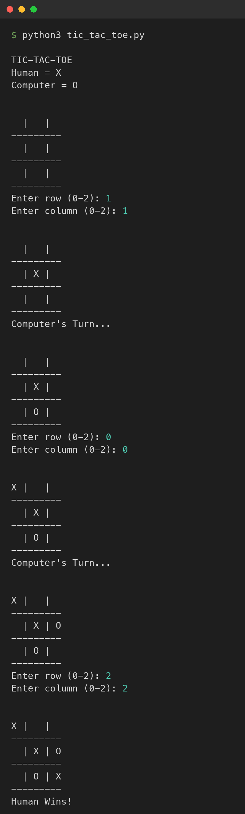
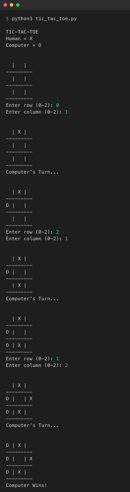

# Tic-Tac-Toe

**Aim:** Implement a two-player Tic-Tac-Toe game (Human vs Computer) without using any standard game-search algorithm.

## Algorithm

1. Represent the board as a 3×3 grid; the human plays `X`, the computer plays `O`.
2. Read the human's row and column, rejecting out-of-range or occupied cells.
3. The computer picks a random empty cell.
4. After every move check all rows, columns and both diagonals for a win, then check for a draw (board full).

## Run

```bash
python3 tic_tac_toe.py
```

## Output

**Human wins**



**Computer wins**


