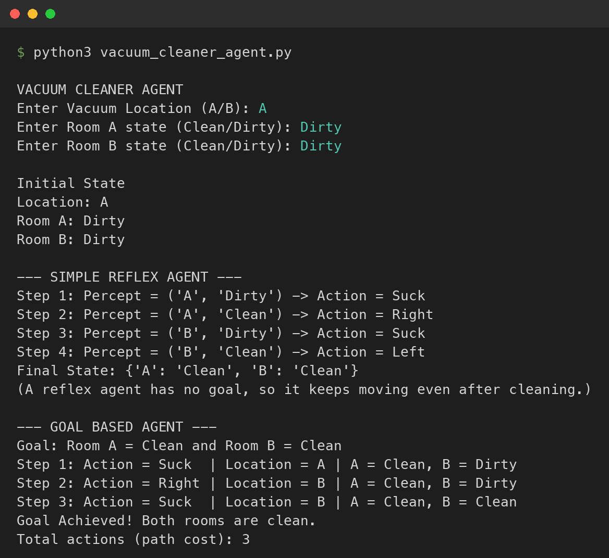

# Vacuum Cleaner Agent

**Aim:** Implement the two-room vacuum cleaner world using the Simple Reflex agent and the Goal-Based agent architectures.

## Algorithm

1. **Simple reflex agent:** acts only on the current percept `(location, status)` using condition–action rules: Dirty → Suck, at A → Right, at B → Left. It has no goal, so it never stops by itself.
2. **Goal-based agent:** keeps a model of both rooms and repeats Suck / move-to-dirty-room until the goal *Room A = Clean and Room B = Clean* holds, then reports the path cost.

## Run

```bash
python3 vacuum_cleaner_agent.py
```

## Output


