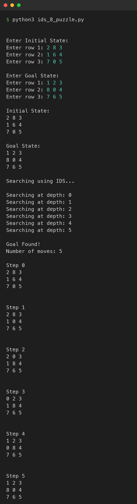

# 8-Puzzle using Iterative Deepening Search

**Aim:** Solve the 8-puzzle problem using the Iterative Deepening Search (IDS) algorithm.

## Algorithm

1. Run Depth-Limited Search (DLS) with limit 0, 1, 2, … until the goal is found.
2. DLS explores depth-first but never goes deeper than the current limit, and skips states already on the current path.
3. IDS combines DFS's low memory use with BFS's guarantee of finding the shallowest solution.
4. A solvability check is done first, so the search never loops on an unsolvable puzzle.

## Run

```bash
python3 ids_8_puzzle.py
```

## Output


