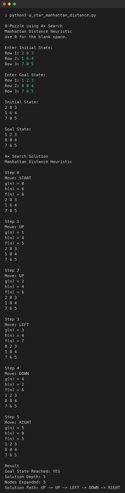

# 8-Puzzle using A* (Manhattan Distance)

**Aim:** Solve the 8-puzzle with A* search where f(n) = g(n) + h(n), g(n) = depth of the node and h(n) = Manhattan distance.

## Algorithm

1. Same A* procedure as the misplaced-tiles version.
2. h(n) is the sum over tiles of |row − goal_row| + |col − goal_col| (following the lab's convention, as in the example h(n) = 6).
3. Manhattan distance is a more informed heuristic, so A* usually expands fewer nodes.

## Run

```bash
python3 a_star_manhattan_distance.py
```

## Output


