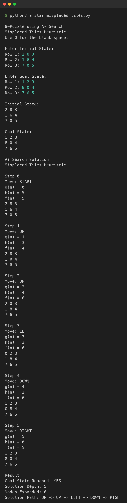

# 8-Puzzle using A* (Misplaced Tiles)

**Aim:** Solve the 8-puzzle with A* search where f(n) = g(n) + h(n), g(n) = depth of the node and h(n) = number of misplaced tiles.

## Algorithm

1. Keep a priority queue (open list) ordered by f(n).
2. Pop the node with the smallest f(n); stop if it is the goal.
3. Expand it, and for each child with a better g(n) record its parent and push it with f = g + h.
4. h(n) counts the positions where the state differs from the goal (following the lab's convention, as in the example h(n) = 5).

## Run

```bash
python3 a_star_misplaced_tiles.py
```

## Output


