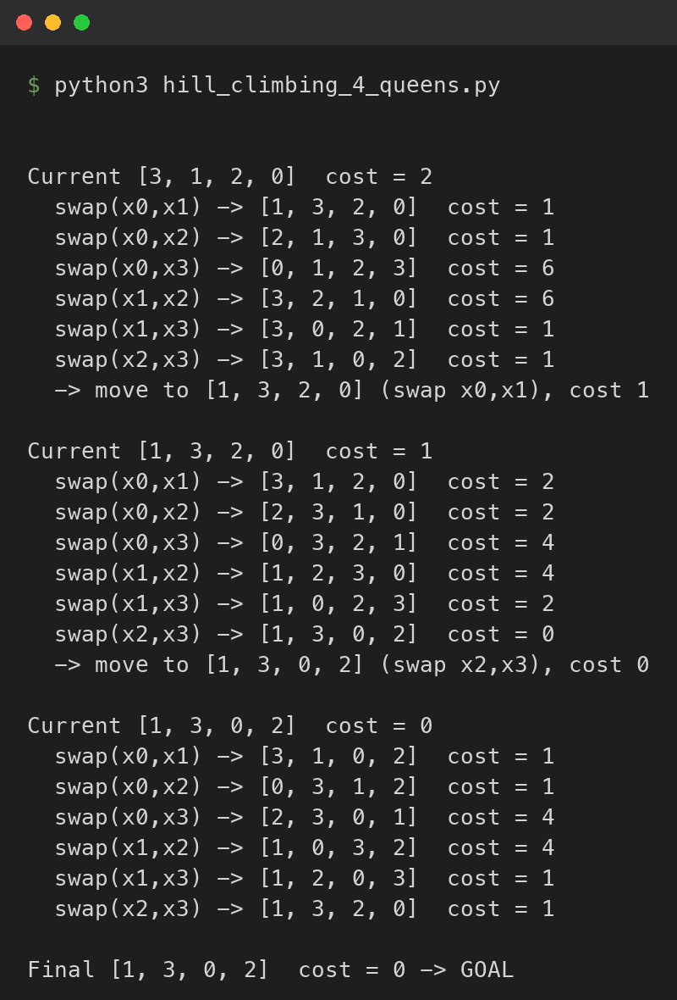

# Hill Climbing for 4-Queens

**Aim:** Implement the Hill Climbing search algorithm to solve the N-Queens problem (N = 4).

## Algorithm

1. State: `x[i]` = row of the queen in column i. Initial state from the lab: x0 = 3, x1 = 1, x2 = 2, x3 = 0.
2. Neighbours: swap the row positions of two queens.
3. Cost: number of pairs of queens attacking each other.
4. Move to the best neighbour while it strictly lowers the cost; on ties choose the swap with the smallest column numbers.
5. Stop at cost 0 (goal) or when no neighbour is better (local minimum).

## Run

```bash
python3 hill_climbing_4_queens.py
```

## Output


