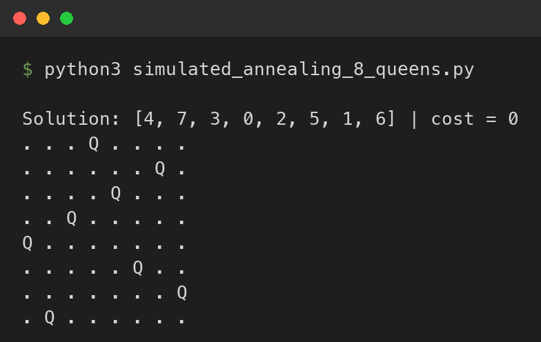

# Simulated Annealing for 8-Queens

**Aim:** Implement Simulated Annealing to solve the 8-Queens problem.

## Algorithm

1. Start from a random board and a high temperature T.
2. Pick a random neighbour (move one queen to a random row) and compute ΔE = cost(current) − cost(next).
3. Always accept a better move; accept a worse move with probability e^(ΔE / T).
4. Cool down (T ← α·T) and repeat until cost = 0 or T is very small.

## Run

```bash
python3 simulated_annealing_8_queens.py
```

## Output


