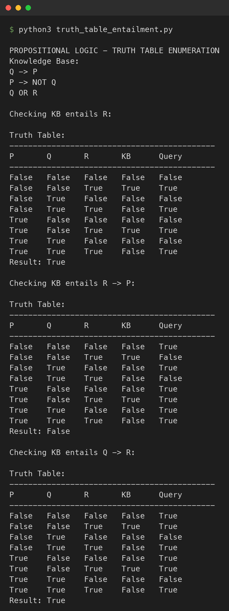

# Propositional Logic: Truth-Table Entailment

**Aim:** Create a knowledge base using propositional logic and show whether a given query is entailed by the knowledge base.

## Algorithm

1. KB: `Q → P`, `P → ¬Q`, `Q ∨ R`.
2. Enumerate all 2³ models of P, Q, R (TT-ENTAILS).
3. KB ⊨ α holds if α is true in every model where the KB is true.
4. Queries checked: `R` (entailed), `R → P` (not entailed), `Q → R` (entailed).

## Run

```bash
python3 truth_table_entailment.py
```

## Output


