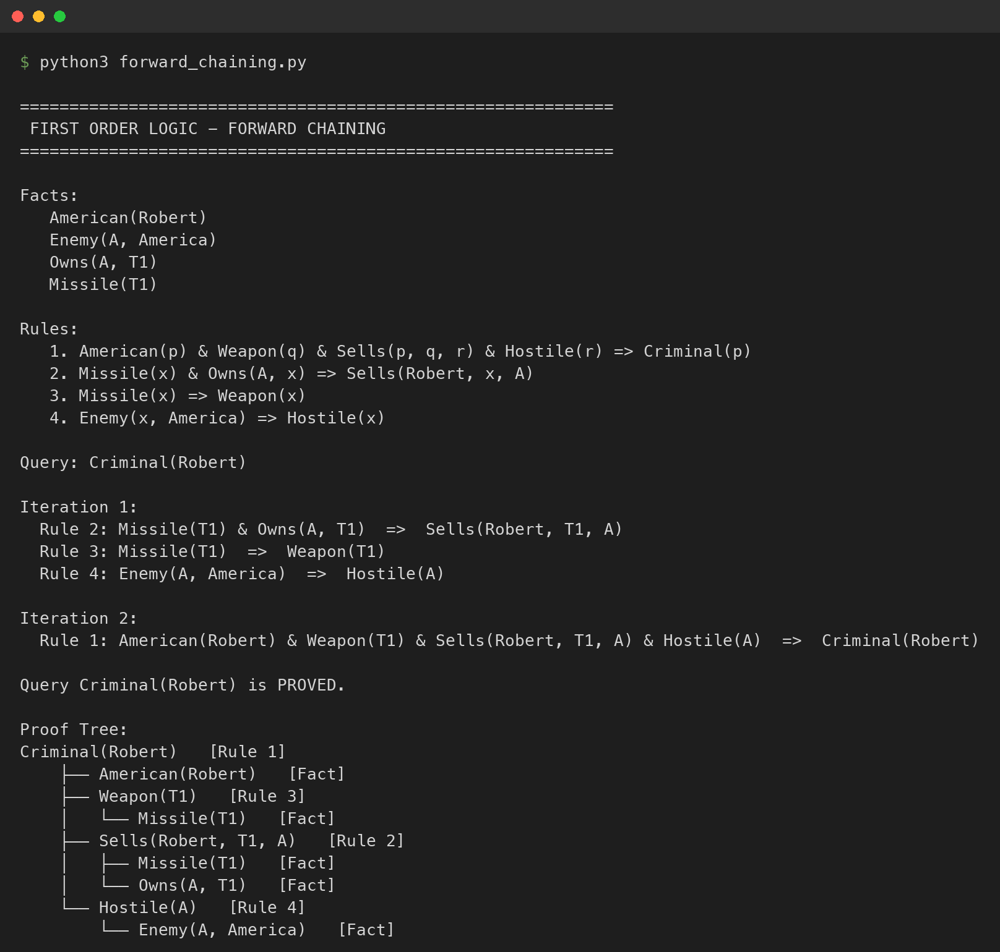

# Forward Chaining in First Order Logic

**Aim:** Create a knowledge base of first order logic statements and prove the given query using forward reasoning.

## Algorithm

1. Case study: *it is a crime for an American to sell weapons to hostile nations…*; prove `Criminal(Robert)`.
2. Facts: `American(Robert)`, `Enemy(A, America)`, `Owns(A, T1)`, `Missile(T1)` (T1 from existential instantiation).
3. On each iteration, standardize each rule's variables, find every substitution that unifies all its premises with known facts, and add the new conclusions.
4. Stop as soon as the query is inferred (or nothing new can be inferred), then print the proof tree.

## Run

```bash
python3 forward_chaining.py
```

## Output


