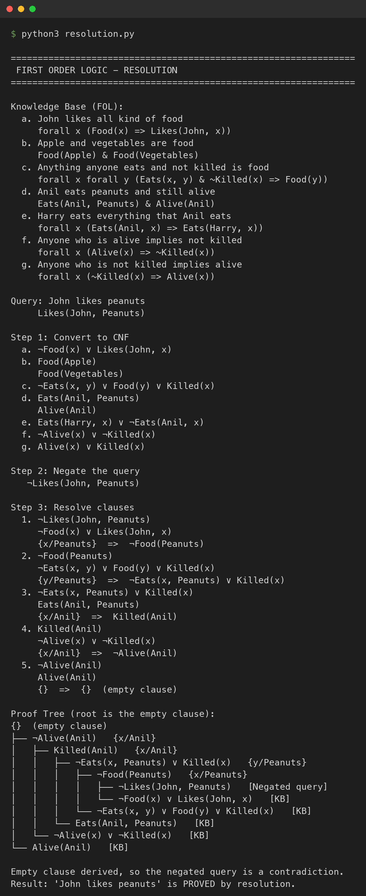

# Resolution in First Order Logic

**Aim:** Create a knowledge base of first order logic statements and prove the given query using resolution.

## Algorithm

1. Case study: *John likes all kind of food…*; prove `Likes(John, Peanuts)`.
2. Convert every sentence to CNF: eliminate ⇒/⇔, move ¬ inwards, standardize variables, skolemize, drop ∀, distribute ∨ over ∧.
3. Negate the query and add it to the clause set.
4. Repeatedly resolve clauses (set of support, unit preference) using unification until the empty clause `{}` is produced.
5. Deriving `{}` means the negated query contradicts the KB, so the query is proved. The proof tree is printed.

## Run

```bash
python3 resolution.py
```

## Output


