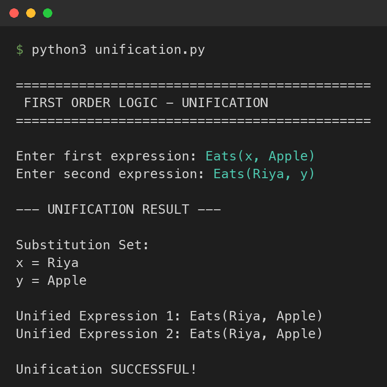
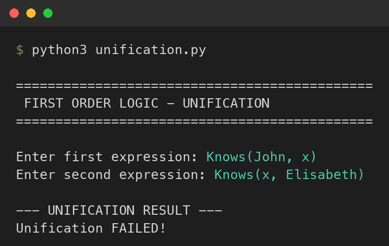

# Unification in First Order Logic

**Aim:** Implement the unification algorithm for first order logic.

## Algorithm

1. Parse both expressions into predicate / function / variable / constant terms.
2. If the terms are identical, return the current substitution.
3. If one is a variable, bind it (with an occurs check).
4. Fail if predicate/function symbols or numbers of arguments differ.
5. Otherwise unify the arguments pairwise, building up the substitution set (MGU).

## Run

```bash
python3 unification.py
```

## Output

**Successful unification**



**Failed unification**


