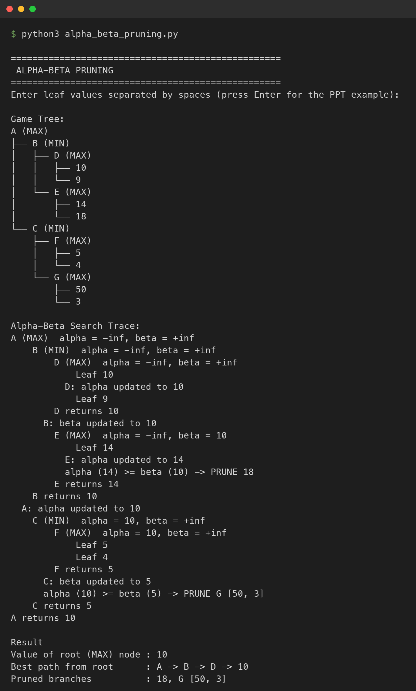

# Alpha-Beta Pruning

**Aim:** Implement Alpha-Beta Pruning to find the value of the root (MAX) node and identify the pruned branches.

## Algorithm

1. α = best value MAX can guarantee so far, β = best value MIN can guarantee so far.
2. MAX nodes update α, MIN nodes update β, as values come back up the tree.
3. As soon as α ≥ β at a node, its remaining children are pruned.
4. Default tree from the lab (leaves 10 9 14 18 5 4 50 3): root value **10**, pruned **18** and subtree **G [50, 3]**. Any other power-of-2 set of leaves can be entered.

## Run

```bash
python3 alpha_beta_pruning.py
```

## Output


