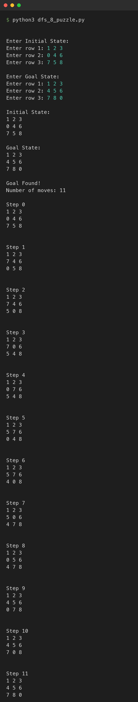

# 8-Puzzle using Depth First Search

**Aim:** Solve the 8-puzzle problem using Depth First Search (DFS).

## Algorithm

1. Represent a state as a 9-tuple, with `0` as the blank.
2. Check solvability first: start and goal must have the same inversion-count parity.
3. Use a stack (LIFO) of `(state, path)` and a visited set.
4. Pop a state, generate its children by sliding the blank in the order Left, Down, Up, Right (the order used in the lab's DFS tree), and push the unvisited ones.
5. Stop when the goal state is reached and print the path.

## Run

```bash
python3 dfs_8_puzzle.py
```

## Output


